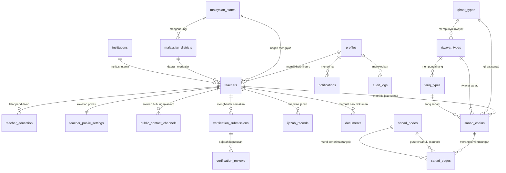

# Senibina Pangkalan Data & Skema PostgreSQL (DATABASE_SCHEMA.md)

MySanad menggunakan **Supabase PostgreSQL** dengan 20 jadual teras yang direka bentuk khusus untuk memodelkan rangkaian sanad bercabang, perkongsian nod perawi sejarah merentas guru, pengesahan berasingan, dan perlindungan privasi melalui Row Level Security (RLS).

## 1. Rajah Perhubungan Entiti (Mermaid ERD)

## 2. Senarai Lengkap 20 Jadual Pangkalan Data

| No. | Nama Jadual | Kunci Utama | Fungsi Utama |
| :--- | :--- | :--- | :--- |
| 1 | `profiles` | `id (UUID)` | Akaun pengguna bersepadu dengan `auth.users` dan peranan RBAC (`super_admin`, `verification_admin`, `registered_teacher`, `public_visitor`). |
| 2 | `teachers` | `id (UUID)` | Rekod guru al-Quran berserta kod unik `MSN-000001`, lokasi mengajar vs kediaman, dan status pengesahan profil. |
| 3 | `teacher_education` | `id (UUID)` | Sejarah pengajian akademik, pondok, atau maahad tahfiz bagi setiap guru. |
| 4 | `institutions` | `id (UUID)` | Direktori institusi pengajian al-Quran, universiti, maahad tahfiz, dan pusat pengajian. |
| 5 | `qiraat_types` | `id (UUID)` | Data rujukan Imam Qiraat Sepuluh/Tujuh Mutawatirah. |
| 6 | `riwayat_types` | `id (UUID)` | Data rujukan Perawi bagi setiap Imam Qiraat (cth: Hafs 'an 'Asim, Syu'bah, Qalun, Warsy). |
| 7 | `tariq_types` | `id (UUID)` | Data rujukan Tariq pengajian (cth: al-Syatibiyyah, Tayyibat al-Nasyr, al-Durrah). |
| 8 | `sanad_chains` | `id (UUID)` | Rekod induk jalur sanad milik seseorang guru mengikut Qiraat, Riwayat, dan Tariq. |
| 9 | `sanad_nodes` | `id (UUID)` | Nod perawi/ulama dalam rantaian sanad (boleh dikongsi merentas pelbagai jalur sanad tanpa penduaan palsu). |
| 10 | `sanad_edges` | `id (UUID)` | Hubungan berarah (`source_node_id` -> `target_node_id`) bagi sesuatu jalur sanad berserta kaedah talaqqi dan status semakan. |
| 11 | `ijazah_records` | `id (UUID)` | Rekod penganugerahan ijazah al-Quran yang diterima oleh guru. |
| 12 | `documents` | `id (UUID)` | Metadata fail PDF/imej sijil di dalam bucket peribadi Supabase Storage (`private-ijazah-documents`). |
| 13 | `verification_submissions` | `id (UUID)` | Baris gilir permohonan semakan bagi profil, dokumen, jalur sanad, nod, atau hubungan transmisi. |
| 14 | `verification_reviews` | `id (UUID)` | Log keputusan semakan, komen dalaman pentadbir, dan maklum balas pembetulan kepada guru. |
| 15 | `teacher_public_settings` | `id (UUID)` | Tetapan keizinan privasi guru (papar foto, institusi, tarikh ijazah, graf sanad, muat turun graf). |
| 16 | `notifications` | `id (UUID)` | Sistem pemberitahuan dalam aplikasi bagi setiap perubahan status pengesahan dan akaun. |
| 17 | `audit_logs` | `id (UUID)` | Rekod jejak audit keselamatan (pelaku, tindakan, nilai lama/baharu, masa, IP). |
| 18 | `public_contact_channels` | `id (UUID)` | Saluran perhubungan rasmi yang diluluskan untuk dipaparkan kepada masyarakat awam. |
| 19 | `malaysian_states` | `id (UUID)` | 13 Negeri dan 3 Wilayah Persekutuan Malaysia berserta `slug` dan rantau. |
| 20 | `malaysian_districts` | `id (UUID)` | Senarai daerah/jajahan di bawah setiap negeri yang boleh dikonfigurasi oleh pentadbir. |

## Migrasi 005 — Pengerasan keselamatan (Fasa 1)
- Fungsi pembantu: `is_trusted_backend`, `owner_status_change_allowed`, `is_teacher_public`, `is_sanad_chain_public`, `owns_teacher`, `submission_target_belongs_to_teacher`.
- Trigger pengawal `guard_*` pada `profiles`, `teachers`, `teacher_education`, `ijazah_records`, `public_contact_channels`, `sanad_chains`, `sanad_nodes`, `sanad_edges`, `documents` dan `verification_submissions`.
- Kod unik berjujukan: `teacher_code` (MSN-000001), `sanad_code` (SND-000001), `submission_code` (SUB-000001).
- Indeks unik: hanya satu permohonan terbuka (`submitted`/`under_review`) bagi setiap rekod sasaran.
- Trigger `on_auth_user_created` mencipta `profiles` secara automatik; `on_auth_user_email_changed` menyelaraskan emel.
- Trigger audit `trg_audit_*`; `audit_logs` tambah-sahaja; fungsi `log_audit_event`.
- Jadual `rate_limits` + fungsi `consume_rate_limit` (service role sahaja).
- View awam `v_public_teachers` (dibina semula) dan `v_public_sanad_chains` (baharu).
- Bucket storan `teacher-photos` serta polisi `storage.objects` untuk kedua-dua bucket.

## Migrasi 006 — Direktori awam (Fasa 2)
- `normalize_search_text(text)`: huruf kecil; buang harakat, tatweel dan apostrof; satukan varian alif, ya dan ta marbutah.
- `teachers.search_document` (trigger `trg_teachers_search_document`) + indeks trigram GIN.
- `search_public_teachers(...)`: satu-satunya pintu carian awam (guru diterbitkan sahaja). Mencari nama Rumi/Arab, ejaan alternatif, institusi, negeri, daerah, qiraat dan riwayat; tapisan; penomboran; jumlah keseluruhan.
- `get_public_teacher_profile(uuid)`: profil awam lengkap yang mematuhi tetapan keterlihatan guru.
- `public_platform_stats()`, `v_public_state_stats`, `v_public_district_stats`, `v_public_institutions`: statistik sebenar.
- Bacaan awam terus pada `teacher_education`, `ijazah_records` dan `public_contact_channels` dikeluarkan; data awam hanya melalui `get_public_teacher_profile`.

## Migrasi 007 — Portal guru (Fasa 3)
- `updated_at` dikemas kini automatik (trigger `trg_zz_set_updated_at`).
- `teachers.teaching_state_id` kini boleh kosong semasa draf; wajib semasa penghantaran. Lajur baharu `onboarding_step` (2–7).
- `submit_my_teacher_profile(notes)` / `withdraw_my_teacher_submission()`: penghantaran atomik yang disahkan; guru tidak lagi boleh menukar status profil secara terus.
- Kunci kandungan: profil `under_review`/`approved`/`published`/`rejected`/`suspended` tidak boleh disunting terus (kecuali telefon dan alamat kediaman).
- Jadual baharu `teacher_change_requests` (medan senarai putih, satu permohonan terbuka setiap guru).
- Pendidikan/ijazah yang telah disemak dan disunting oleh guru kembali ke `submitted`.
- Guru boleh mencadangkan institusi (sentiasa `is_verified = FALSE`; unik mengikut nama ternormal + negeri).
- Polisi storan: pemilik boleh membaca objek foto sendiri.

## Migrasi 008 — Pengurusan sanad (Fasa 4)
**Arah hubungan:** `sanad_edges.source_node_id` = guru (pemberi), `target_node_id` = murid (penerima).

- `sanad_edges`: lajur baharu `transmission_date_text`, `transmission_location`, `notes` (sulit); unik `(sanad_chain_id, source_node_id, target_node_id)`; trigger menolak kitaran dalam rantaian.
- `sanad_chains.supersedes_chain_id`: semakan baharu bagi rantaian yang telah diluluskan (satu semakan terbuka sahaja).
- `sanad_nodes`: satu nod bagi setiap guru (`linked_teacher_id` unik), dicipta oleh `ensure_my_sanad_node()`.
- Jadual baharu `sanad_chain_revisions` (snapshot JSON bagi setiap penghantaran/tarik balik/semakan).
- Fungsi: `submit_my_sanad_chain`, `withdraw_my_sanad_chain`, `revise_my_sanad_chain`, `search_linkable_sanad_nodes`, `get_public_sanad_graph`, `can_use_sanad_node`.
- Rantaian dan hubungannya boleh disunting hanya ketika `draft` atau `revision_required`. Nod hanya boleh disunting oleh pencipta ketika `draft`/`revision_required`.
- Penghantaran mengesahkan: rantaian berakhir pada nod guru, semua perawi bersambung kepada guru; mengira `generation_depth` dan syeikh langsung.

## Migrasi 009 — Dokumen (Fasa 5)
- Sisipan terus ke `documents` oleh guru dibuang; pendaftaran hanya melalui `register_my_document(...)`, yang mengesahkan objek wujud dalam folder pemilik (dan saiznya sepadan dengan `storage.objects.metadata`), pemilikan rantaian/ijazah yang dikaitkan, had 50 dokumen setiap guru, membersihkan nama fail, dan mencipta permohonan semakan `ijazah_document`.
- `delete_my_document(id)`: hanya status `draft`/`submitted`/`revision_required`/`rejected`; menutup permohonan terbuka; mengembalikan laluan storan untuk dibuang oleh pelayan.
- Indeks `idx_documents_teacher`, `idx_documents_review_status`.

## Migrasi 010 — Semakan pentadbir (Fasa 6)
- Fungsi keputusan (SECURITY DEFINER, `require_admin()`): `admin_start_review`, `admin_decide_submission` (approve/publish/revision_required/reject), `admin_decide_change_request`, `admin_set_publication` (publish/unpublish/suspend/reinstate), `admin_set_featured`, `admin_set_item_status` (senarai putih jadual), `admin_get_teacher_ic_ciphertext` (sebab wajib + audit), `admin_dashboard_counts`.
- Setiap keputusan dalam satu transaksi: rekod sasaran → permohonan → `verification_reviews` → lencana → notifikasi.
- Lencana terbitan: `refresh_teacher_badges()` (dokumen diluluskan / rantaian awam diluluskan).
- Kelulusan rantaian ditolak jika ada perawi/hubungan berstatus pembetulan/ditolak; semakan baharu yang diluluskan menggantung rantaian yang digantikan.
- `notifications`: jenis diperluas; guru hanya boleh menanda dibaca atau memadam; `notify_teacher()` dalaman.

## Migrasi 011 — Tetapan, analitik, data rujukan (Fasa 7)
- Jadual `system_settings` (kunci tetap: `registration_open`, `announcement`, `contact_email`, `max_documents_per_teacher`); nilai disahkan mengikut jenis oleh trigger; hanya Super Admin boleh mengubah; tetapan awam boleh dibaca oleh pelawat.
- `handle_new_auth_user()` menolak akaun baharu apabila pendaftaran ditutup (berkuat kuasa walaupun API Auth dipanggil terus).
- `max_documents_per_teacher()` kini membaca tetapan.
- Audit untuk `malaysian_districts`, `qiraat_types`, `riwayat_types`, `tariq_types`, `system_settings`; semakan format kod/slug; kod unik untuk perawi rujukan (`sanad_nodes.canonical_code`).
- `admin_analytics()`: 12 bulan pendaftaran/penerbitan/keputusan, status guru, guru mengikut negeri, rantaian mengikut riwayat, status dokumen, masa semakan (median/P90), institusi teratas.

## Migrasi 012 — Paparan awam sijil sanad, Qiraat & Riwayat
- `documents.show_publicly` (lalai `FALSE`): guru meminta Sijil Ijazah Sanad dipaparkan pada profil awam.
- Sijil dipaparkan hanya jika guru meminta, pentadbir meluluskan (`approved`/`published`) dan profil guru awam
  (`is_public_sanad_document`). Bucket kekal peribadi.
- `register_my_document(..., p_show_publicly)` — parameter baharu (lalai `FALSE`); hanya kategori Sijil Ijazah Sanad.
- `set_my_document_public(id, show)` — guru: sembunyi serta-merta; paparkan sijil yang sudah lulus menghantarnya untuk
  semakan semula (status `submitted` + permohonan baharu).
- `get_public_sanad_documents(teacher_id)` — awam: id, jenis fail, rantaian awam berkaitan, tarikh semakan (tiada nama fail
  atau laluan storan).
- `public_sanad_document_path(id)` — service role sahaja; digunakan oleh `/api/public-documents/{id}`.
- `public_qiraat_riwayat_stats()` — awam: bilangan guru diterbitkan bagi setiap qiraat dan riwayat (peraturan sama dengan
  tapisan direktori).

## Migrasi 013 — Guru diurus pentadbir
- `teachers.profile_id` boleh NULL; `teachers.managed_by_admin`; kekangan `chk_teachers_owner_or_managed`
  (setiap guru mempunyai akaun atau diurus pentadbir).
- `acting_teacher_id(p_teacher_id)` / `can_act_for_teacher(id)`: guru bertindak untuk diri sendiri; pentadbir untuk mana-mana guru.
- Parameter pilihan `p_teacher_id` (pentadbir sahaja): `submit_my_teacher_profile`, `ensure_my_sanad_node`,
  `register_my_document`. Fungsi rantaian dan `set_my_document_public` menerima pemilik atau pentadbir.
- RLS: pentadbir boleh menulis `teacher_education`.
- `v_public_teachers` / `is_teacher_public`: profil tanpa akaun dipaparkan apabila diterbitkan.
- `notify_teacher` melangkau guru tanpa akaun. `notify_admin_edit` (pencetus) + `record_admin_edit`: notifikasi
  `profile_updated_by_admin` kepada guru berakaun apabila pentadbir menyunting terus (sekali setiap 30 minit).
- `admin_link_teacher_account(teacher_id, email)`: pautkan profil diurus kepada akaun berdaftar (notifikasi `account_linked`).

## Migrasi 014 — Qiraat tambahan, sanad ringkas
- Qiraat baharu: `Q08-ABUJAFAR` (Ibn Wardan, Ibn Jammaz), `Q09-YAQUB` (Ruwais, Rauh), `Q10-KHALAF` (Ishaq, Idris),
  dan `Q-SABAH` Qiraat Tujuh (riwayat `R-JAM-SABAH`), disusun sebelum Qiraat Sepuluh Mutawatirah.
- Riwayat tambahan: Ibn 'Amir (Hisyam, Ibn Zakwan), Hamzah (Khalaf, Khallad), al-Kisa'i (Abu al-Harith, Duri al-Kisa'i).
  Kini setiap imam qiraat sepuluh mempunyai dua perawi.
- Riwayat Qiraat Sepuluh: Jam'ul Qiraat al-'Asyar, diikuti `R-JAM-ASHARAH-SUGHRA` dan `R-JAM-ASHARAH-KUBRA`.
- `sanad_nodes.generation_category` kini boleh NULL: guru hanya memasukkan nama perawi.
- Kaedah pengambilan (semua secara talaqqi musyafahah): bacaan secara hafazan (ghaiban, lalai), melihat mushaf,
  atau dalam talian (online). Nilai lama dikekalkan sehingga disunting.

## Migrasi 015 — Kaedah pengambilan tidak wajib
- `sanad_chains.transmission_method` dan `sanad_edges.transmission_relationship` boleh NULL, tanpa nilai lalai.

## Migrasi 016 — Penanda profil diurus pentadbir
- `v_public_teachers.managed_by_admin` (lajur ditambah di hujung); profil awam memaparkan penafian yang sesuai.

## Migrasi 017 — Rantaian rujukan
- `reference_chains` (draf / aktif / tidak aktif, `root_node_id` = perawi permulaan) dan `reference_chain_links`.
- Pentadbir mengurus semuanya; guru hanya membaca rantaian **aktif** semasa tetapan `reference_chains_enabled` hidup.
- Hubungan dikunci semasa rantaian aktif (nyahaktifkan untuk menyunting). Status diubah melalui
  `admin_set_reference_chain_status()`; pengaktifan memastikan semua perawi bersambung dan menjadikan perawinya disahkan.
- `admin_create_reference_from_chain()`: salin bahagian atas rantaian yang diluluskan sebagai draf.
- `attach_reference_chain()`: **menyalin** bahagian rujukan ke dalam rantaian guru (draf) sebagai hubungan biasa yang disemak
  bersama rantaian. Suntingan atau pemadaman rujukan kemudian tidak mengubah rantaian guru.
- Boleh dibuang sepenuhnya tanpa menjejaskan data guru: padam dua jadual dan fungsi di atas.
